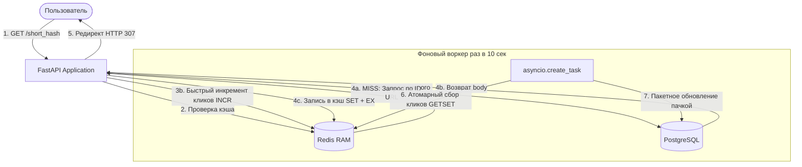

# ⚡ Асинхронный Highload URL Shortener (Cокращатель ссылок)

Высокопроизводительный, отказоустойчивый микросервисный REST API сервис для сокращения URL-адресов. Архитектура спроектирована с акцентом на асинхронность, оптимизацию дискового ввода-вывода (I/O) и защиту от DDoS/перебора чужих ссылок.

---

## 🛠️ Стек технологий

*   **Бэкенд:** Python 3.13, FastAPI, Asyncio
*   **База данных (Persistent):** PostgreSQL, SQLAlchemy 2.0 (AsyncSession), asyncpg
*   **Кэш и Аналитика (In-Memory):** Redis (redis-py асинхронный клиент)
*   **Валидация и Безопасность:** Pydantic v2 (ConfigDict), SlowAPI (Rate Limiting), Hashids
*   **Тестирование:** Pytest, pytest-asyncio, HTTPX (ASGITransport)
*   **Оркестрация и DevOps:** Docker, Docker-compose, Lifespan API

---

## 🏗️ Архитектура и Движение данных (Data Flow)

Сервис реализует паттерн **Cache Aside** для быстрого чтения ссылок и **Write-Behind Caching (Batching)** для записи аналитики кликов пачками. Короткие хэши генерируются «на лету» на основе первичных ключей (ID) и не хранятся в постоянной СУБД.



---

## 🚀 Ключевые архитектурные решения

1. **Пакетная запись кликов (Batching / Write-Behind):** Для защиты PostgreSQL от деградации при высокой нагрузке на запись (`Write-heavy`), клики аккумулируются в оперативной памяти Redis через атомарный `INCR`. Фоновый асинхронный воркер раз в 10 секунд сбрасывает их одной транзакцией в Postgres, используя безопасный `GETSET` для предотвращения состояния гонки (`Race Condition`).
2. **Оптимизация хранения (Без short_url в БД):** В базе данных не хранятся длинные строки доменов. Короткий хэш генерируется на лету через `Hashids` на основе числового ID записи из Postgres. При редиректе хэш декодируется обратно в ID в коде Python, выполняя моментальный `O(1)` поиск по первичному ключу.
3. **Безопасность и защита от перебора:**
    *   **Сквозное шифрование ID:** Алгоритм `Hashids` со скрытой солью (`salt`) превращает последовательные ID (`1, 2, 3...`) в хаотичные строки (`gY7v9B`, `mP3k1A`), исключая уязвимости класса IDOR (перебор чужих ссылок).
    *   **Rate Limiting:** Интегрирована библиотека `SlowAPI`. Эндпоинт создания ссылок защищен лимитом в 5 запросов в минуту с одного IP. Лимиты синхронизируются централизованно через Redis.
4. **Умный запуск (Healthchecks):** В `docker-compose` настроена проверка здоровья базы данных с помощью утилиты `pg_isready`. Бэкенд дожидается полной готовности СУБД к приему соединений, полностью исключая ошибку `ConnectionRefusedError` при холодном старте.

---

## 🧪 Тестирование (Pytest-asyncio)

В проекте реализовано полное асинхронное интеграционное тестирование эндпоинтов с использованием изолированных тестовых сред (`In-Memory SQLite` и очисткой тестовой БД/Redis перед каждым тестом).

Для запуска тестов внутри Docker-контейнера выполните команду:
```bash
docker-compose run --rm backend pytest
```

---

## 💻 Быстрый запуск (Локально)

### 1. Клонирование репозитория
```bash
git clone https://github.com
cd short-link-fastapi
```

### 2. Настройка конфигурации
Создайте файл `.env` в корне проекта (он добавлен в `.gitignore` и не попадет в репозиторий):
```env
HASHIDS_SALT=your_super_secret_salt_phrase
POSTGRES_USER=postgres
POSTGRES_PASSWORD=postgres
POSTGRES_DB=database_db
POSTGRES_HOST=db
POSTGRES_PORT=5432
REDIS_HOST=redis
REDIS_PORT=6379
```

### 3. Запуск через Docker-compose
```bash
docker-compose up --build
```
После успешной сборки сервис будет доступен по адресу: `http://localhost:8000`
Интерактивная документация (Swagger UI) доступна по адресу: `http://localhost:8000/docs`

---

## 📋 Примеры использования (API Endpoints)

### 1. Создание короткой ссылки
*   **Запрос:** `POST /shorten`
*   **Тело запроса (JSON):**
    ```json
    {
      "long_url": "https://google.com"
    }
    ```
*   **Ответ (JSON):**
    ```json
    {
      "id": 1,
      "body": "https://google.com",
      "short_url": "http://127.0.0",
      "clicks": 0
    }
    ```

### 2. Переход по ссылке (Редирект)
*   **Запрос:** `GET /gY7v9B`
*   **Результат:** HTTP Статус `307 Временный редирект` на `https://google.com`.

### 3. Получение статистики кликов в реальном времени
*   **Запрос:** `GET /stat/gY7v9B`
*   **Ответ (JSON):**
    ```json
    {
      "short_hash": "gY7v9B",
      "original_url": "https://google.com",
      "clicks": 14
    }
    ```
*(Данные суммируют зафиксированные клики из Postgres и кэш кликов, находящийся в Redis в момент запроса).*
